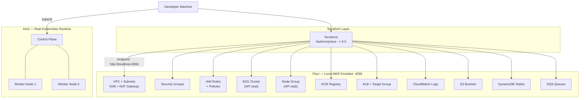

# terraform-floci-infrastructure

A local DevOps lab for practicing AWS infrastructure and Kubernetes — entirely on your laptop. No AWS account, no cloud costs, no credit card.

This repository uses **[Floci](https://github.com/floci-io/floci)** to emulate AWS services locally and **Terraform** to provision infrastructure against them. **Kind** provides a real Kubernetes runtime for workload practice.

---

## What this is

A production-style Infrastructure as Code repository where you can practice:

- Writing and running real Terraform modules (VPC, EKS, IAM, ECR, ALB, and more)
- Working with AWS-compatible services locally via Floci
- Deploying Kubernetes workloads with Kind
- CI/CD pipelines, Helm, ingress controllers, RBAC, monitoring, and logging

Everything runs locally. The same Terraform code, the same AWS CLI commands, the same Kubernetes manifests — just pointed at `localhost:4566` instead of real AWS.

---

## Architecture



> **Important:** Floci emulates the EKS control-plane API (CreateCluster, DescribeCluster, CreateNodegroup). It does not run a real Kubernetes API server or launch EC2 worker nodes. Kind provides the actual Kubernetes runtime.

---

## What's in this repository

| Path | Purpose |
|---|---|
| `infrastructure/environments/local/` | Basic AWS services (S3, DynamoDB, SQS) |
| `infrastructure/environments/eks-local/` | EKS-like infrastructure (VPC, IAM, EKS, ECR, ALB) |
| `infrastructure/modules/` | Reusable Terraform modules |
| `state-bootstrap/` | One-time setup for Floci-backed remote Terraform state |
| `floci/` | Docker Compose configuration for Floci |
| `scripts/` | Bash automation scripts |
| `docs/` | Detailed documentation |

---

## Prerequisites

| Tool | Version | Purpose |
|---|---|---|
| Docker | 24+ | Runs Floci and Kind |
| Floci | latest | Local AWS emulator |
| Terraform | 1.6+ | Infrastructure as Code |
| AWS CLI | v2 | Verifying resources |
| kubectl | 1.31+ | Kubernetes operations |
| Kind | 0.24+ | Local Kubernetes cluster |
| Helm | 3+ | Kubernetes package manager |

> **Windows users:** all commands must be run inside WSL 2.

---

## Quick Start

```bash
# 1. Clone
git clone <repo-url>
cd terraform-floci-infrastructure

# 2. Start Floci
floci start          # via CLI (recommended)
# OR
docker compose -f floci/docker-compose.yml up -d

# 3. Provision basic AWS services (S3, DynamoDB, SQS)
cd infrastructure/environments/local
terraform init
terraform apply

# 4. Provision EKS-like infrastructure
cd ../eks-local
terraform init
terraform apply

# 5. Verify resources
export AWS_PAGER=""
aws --endpoint-url http://localhost:4566 --no-cli-pager eks list-clusters
aws --endpoint-url http://localhost:4566 --no-cli-pager ec2 describe-vpcs \
  --filters Name=tag:project,Values=floci-eks
```

---

## Implementation Status

| Component | Status | Notes |
|---|---|---|
| S3 bucket + versioning | ✅ Implemented & applied | Fully functional in Floci |
| DynamoDB table | ✅ Implemented & applied | Fully functional in Floci |
| SQS queue | ✅ Implemented & applied | Fully functional in Floci |
| VPC + subnets | ✅ Implemented | Verified Floci support |
| Internet Gateway | ✅ Implemented | Verified Floci support |
| NAT Gateway | ✅ Implemented | Verified Floci support |
| Route tables | ✅ Implemented | Verified Floci support |
| Security Groups | ✅ Implemented | Verified Floci support |
| IAM roles + policies | ✅ Implemented | Verified Floci support |
| EKS cluster resource | ✅ Implemented | API stub — no real K8s API server |
| EKS managed node group | ✅ Implemented | API stub — no real EC2 nodes |
| ECR repository | ✅ Implemented | Verified Floci support |
| ALB + target group | ✅ Implemented | Verified Floci support |
| CloudWatch log groups | ✅ Implemented | Verified Floci support |
| State bootstrap (S3+DDB) | ✅ Implemented & applied | Floci-backed remote state |
| Kind Kubernetes cluster | ⏸ Paused | Installed, stopped for now |
| Kubernetes workloads | 🔜 Planned | Requires Kind reactivation |
| Helm charts | 🔜 Planned | |
| Ingress controller | 🔜 Planned | |

---

## Documentation

| Document | Description |
|---|---|
| [Architecture](docs/architecture.md) | Full architecture, design decisions, component interactions |
| [Setup Guide](docs/setup-guide.md) | Installing all prerequisites from scratch |
| [Terraform Guide](docs/terraform-guide.md) | Module reference, workflows, state management |
| [Floci Guide](docs/floci-guide.md) | Floci configuration, supported services, limitations |
| [Kubernetes Guide](docs/kubernetes-guide.md) | Kind setup, deployments, Helm, integration with Floci |
| [Operations](docs/operations.md) | Day-to-day workflows, provisioning, teardown |
| [Troubleshooting](docs/troubleshooting.md) | Common errors and fixes |

---

## Important Disclaimers

- **No real AWS resources are created.** All infrastructure lives in Floci on your machine.
- **EKS in Floci is an API stub.** `aws eks describe-cluster` works; `kubectl` against the returned endpoint does not. Kind provides the real Kubernetes runtime.
- **Credentials are intentional dummies.** `AWS_ACCESS_KEY_ID=test` will not work against real AWS.
- **State files are machine-local.** `terraform.tfstate` is excluded from Git.

---

## License

MIT
