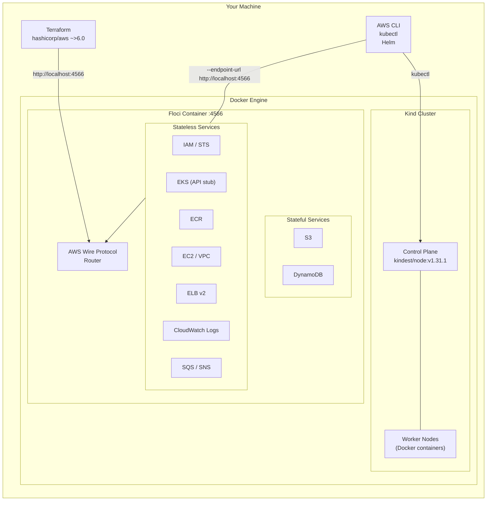
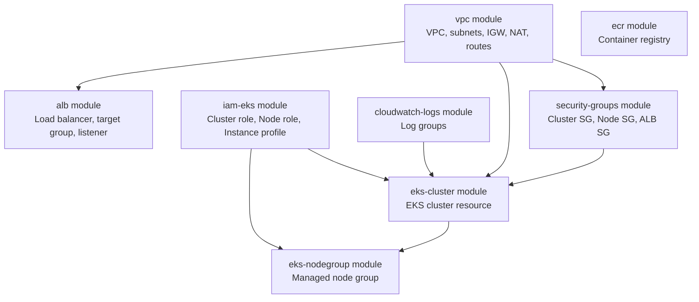

# Architecture

This document explains how all components of the lab fit together and why they are structured the way they are.

---

## Overview

The lab has two distinct layers that complement each other:

**Layer 1 — AWS Infrastructure (Terraform + Floci)**
Terraform provisions AWS-compatible resources against Floci, a local AWS emulator. This layer gives you VPCs, subnets, IAM roles, EKS cluster metadata, ECR repositories, load balancers, and more — all stored and queryable locally without touching real AWS.

**Layer 2 — Kubernetes Runtime (Kind)**
Kind runs a real Kubernetes cluster inside Docker containers. This is where actual workloads run. It simulates the EKS data plane (worker nodes) that Floci's EKS API stub describes but cannot provision.

The two layers are intentionally decoupled. You can provision the entire AWS infrastructure layer and inspect it via the AWS CLI without running Kubernetes at all, and vice versa.

---

## Component Map



---

## Terraform Module Dependency Graph



---

## Two Terraform Environments

The repository contains two separate Terraform environments. They are independent — each has its own state file and can be applied separately.

### `environments/local`

The original environment for practicing basic AWS services.

| Resource | Module |
|---|---|
| S3 bucket + versioning | `modules/s3` |
| DynamoDB table | `modules/dynamodb` |
| SQS queue | `modules/sqs` |

State backend: Floci-backed S3 (`my-terraform-state-cicd-demo` bucket, provisioned by `state-bootstrap`).

### `environments/eks-local`

The EKS-like infrastructure environment.

| Resource | Module |
|---|---|
| VPC, subnets, IGW, NAT Gateway, route tables | `modules/vpc` |
| Security groups (cluster, nodes, ALB) | `modules/security-groups` |
| IAM roles and policies | `modules/iam-eks` |
| EKS cluster | `modules/eks-cluster` |
| EKS managed node group | `modules/eks-nodegroup` |
| ECR repository | `modules/ecr` |
| Application Load Balancer | `modules/alb` |
| CloudWatch log groups | `modules/cloudwatch-logs` |

State backend: local file (`terraform.tfstate`).

---

## EKS: What Floci Actually Does

This is the most important distinction to understand.

### What Floci supports

Floci implements the EKS control-plane API. These calls work and return real responses:

```
eks:CreateCluster
eks:DescribeCluster
eks:ListClusters
eks:CreateNodegroup
eks:DescribeNodegroup
eks:ListNodegroups
eks:DeleteCluster
eks:DeleteNodegroup
```

After `terraform apply`, you can run:

```bash
aws --endpoint-url http://localhost:4566 --no-cli-pager eks list-clusters
# Returns: { "clusters": ["floci-eks-cluster"] }

aws --endpoint-url http://localhost:4566 --no-cli-pager eks describe-cluster \
  --name floci-eks-cluster
# Returns full cluster metadata including VPC config, role ARN, status
```

### What Floci does NOT do

Floci does not spin up a real Kubernetes API server. The `endpoint` returned by `describe-cluster` is a stub URL — `kubectl` cannot connect to it. No real EC2 instances are launched for worker nodes.

### How Kind fills the gap

Kind runs a real Kubernetes cluster with an actual API server and real worker nodes (as Docker containers). When you re-activate Kind later, it acts as the Kubernetes runtime that the Floci-provisioned EKS metadata describes.

```
Floci EKS resource  ←→  Declares the cluster exists in AWS
Kind cluster        ←→  Actually runs Kubernetes workloads
```

This mirrors how real EKS separates the AWS control plane from the EC2 data plane — except here both live on your laptop.

---

## Network Architecture

The VPC is provisioned with the following layout across two availability zones:

```
VPC: 10.0.0.0/16
│
├── Public Subnets (tagged: kubernetes.io/role/elb=1)
│   ├── us-east-1a: 10.0.1.0/24  ← ALB, NAT Gateway EIP
│   └── us-east-1b: 10.0.2.0/24
│
├── Private Subnets (tagged: kubernetes.io/role/internal-elb=1)
│   ├── us-east-1a: 10.0.10.0/24  ← EKS worker nodes
│   └── us-east-1b: 10.0.11.0/24
│
├── Internet Gateway → attached to VPC, routes public subnet traffic
└── NAT Gateway → in public subnet us-east-1a, routes private subnet outbound
```

The Kubernetes subnet tags are intentional. When you deploy an AWS Load Balancer Controller in Kind later, it reads these tags to decide which subnets to use for load balancers.

---

## State Bootstrap

The `state-bootstrap` directory solves the chicken-and-egg problem of remote state:

```
state-bootstrap/ applies ONCE
  → Creates S3 bucket: my-terraform-state-cicd-demo (in Floci)
  → Creates DynamoDB table: terraform-state-lock (in Floci)

environments/local/ uses them as a backend
  → State stored at: s3://my-terraform-state-cicd-demo/environments/local/terraform.tfstate
  → Lock managed by: terraform-state-lock DynamoDB table
```

The `eks-local` environment uses a local backend for now. Migrating it to S3 follows the same pattern — create the resources then update the backend block.

---

## Security Model

This lab uses intentionally dummy credentials throughout:

```
AWS_ACCESS_KEY_ID     = test
AWS_SECRET_ACCESS_KEY = test
AWS_DEFAULT_REGION    = us-east-1
```

Floci accepts any non-empty credentials. IAM policies are stored and queryable but not enforced by default. This is appropriate for a local development environment and must never be used against real AWS.

The Terraform provider is configured to skip all real-AWS validation:

```hcl
skip_credentials_validation = true
skip_metadata_api_check     = true
skip_requesting_account_id  = true
```
